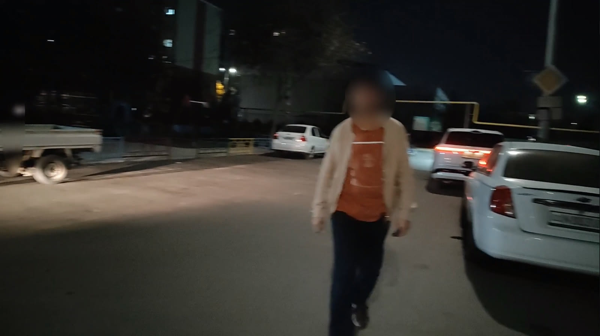

# night-face-blur

Blur faces in a night video. The face spot has three sizes. The detector does not change.

Medium is the blur tuned on night phone video. Soft is a smaller spot. Hard is a wider spot. Faces turned down, the back of a head, and license plates stay visible.



## Run

Open a terminal in the folder that holds the videos.

```
/path/to/night-face-blur
```

The list is only that folder, not folders inside it. Pick a file with the arrow keys and Enter. The first time, pick soft, medium, or hard. The tool checks one frame every 3 seconds and writes `<name>_preview/` with up to four stills that contain a face, then opens the folder. Enter runs the whole video. `n` picks another level. `q` quits.

The finished file is `<name>-blur` next to the original. The original is not replaced. A later video in the same folder starts from the saved level, and still shows its own stills. The saved level is `conf/current`. A new file is written only when the level changes (`medium.txt`, then `soft.txt`, `soft-2.txt`).

To skip the menu:

```
/path/to/night-face-blur --level medium video.mp4
```

## Install

Needs ffmpeg and Python 3.14. This was run on Python 3.14. Other versions were not tried.

```
python3 -m venv .venv
```

```
.venv/bin/pip install -r requirements.txt
```

A video card is optional. Tested on an RTX 3060 Ti with driver 580. If CUDA does not start, the tool says so and runs the detector on the CPU. The blur and the video encode always use the CPU. On two short night clips the CPU was about three times slower than the GPU. A machine with no NVIDIA card was not tried.

The first run downloads `yolov8n-face.onnx` (12 MB) from this project's GitHub release when the file is not already next to the script. The download is checked against a fixed hash.

The weight file comes from [yakhyo/yolov8-face-onnx-inference](https://github.com/yakhyo/yolov8-face-onnx-inference). That repo has no license file. The training project it names, [derronqi/yolov8-face](https://github.com/derronqi/yolov8-face), is GPL-3.0. This script is MIT. The weight is separate and is not in the git tree.
